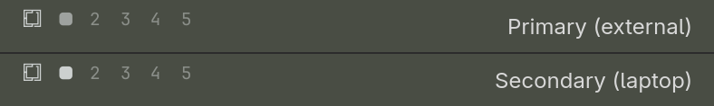

# Monitor Workspaces

Per-monitor workspaces for [Omarchy](https://omarchy.org/). Every monitor gets
its own workspaces 1–0, reached with the same digit keys:

| Keys | Action |
| --- | --- |
| `SUPER + 1…0` | Go to workspace N on the **primary** monitor |
| `SUPER + Right Alt + 1…0` | Go to workspace N on the **secondary** monitor |
| `SUPER + SHIFT + 1…0` | Move the active window to primary workspace N |
| `SUPER + SHIFT + Right Alt + 1…0` | Move the active window to secondary workspace N |

Each screen's bar shows only that screen's workspaces, numbered from 1:



## Why

Hyprland has one global pool of workspaces, and a new workspace opens on
whichever monitor has focus. With a laptop and an external monitor you end up
remembering which screen workspace 4 landed on. Here a number always means the
same screen: `SUPER+3` is always the external's third workspace and
`SUPER+RightAlt+3` is always the laptop's.

## How it works

- **Primary monitor:** any external display while one is connected. The laptop
  panel (`eDP-*`, `LVDS-*` or `DSI-*`) is primary only when it is the only
  screen. Nothing is tied to a port name, so a different dock or monitor works
  the same way.
- **Workspace ids:** the primary owns workspaces 1–10 and the secondary owns
  11–20. The secondary's are labelled 1–0 in its bar.
- **Still dynamic:** workspaces are created when you first go to them, like
  stock Omarchy. If one is created on the wrong screen (a bar click, a script,
  an app), it is moved to its own monitor straight away.
- **Undocking:** with only the laptop screen, both sets live on it and both key
  sets keep working without mixing. The bar shows open secondary workspaces
  after a small gap. When you plug the monitor back in, its workspaces move
  back to it.
- **Bar widget:** replaces Omarchy's built-in workspaces widget. It keeps the
  same behaviour: 1–5 are always shown, and 6–0 appear once they exist.
- **Active marker:** each bar marks the workspace visible on its own screen.
  The screen with focus shows the marker at full strength; the other screen
  shows it dimmed.

## Requirements

- Omarchy with the Lua Hyprland config (`~/.config/hypr/hyprland.lua`)
- One laptop screen plus one external monitor, or two external monitors

Tested on Omarchy 4.0.4 with Hyprland 0.56.2.

## Install

1. Add the plugin and swap it in for the built-in workspaces widget:

   ```bash
   omarchy plugin add https://github.com/BudaiSamuel-dev/omarchy-monitor-workspaces.git
   omarchy plugin enable budaisamuel.workspaces
   ```

   If the bar still shows the old widget, run `omarchy restart shell`.

2. Load the keybindings. Add this to `~/.config/hypr/hyprland.lua`, after the
   `require("hypr.bindings")` line:

   ```lua
   -- Per-monitor workspaces (budaisamuel.workspaces plugin).
   local monitor_workspaces = os.getenv("HOME") .. "/.config/omarchy/plugins/budaisamuel.workspaces/hypr/workspaces.lua"
   if io.open(monitor_workspaces) then dofile(monitor_workspaces) end
   ```

   The `io.open` check keeps Hyprland loading normally if the plugin is ever
   removed.

3. Make Right Alt a modifier of its own. In `~/.config/hypr/input.lua`, add
   `lv3:ralt_switch` to `kb_options` and keep the options you already have.
   With Omarchy's defaults that is:

   ```lua
   hl.config({
     input = {
       kb_options = "compose:caps,shift:both_capslock_cancel,lv3:ralt_switch",
     },
   })
   ```

   Skip this step if you choose a different modifier (see below).

4. Reload and check for errors:

   ```bash
   hyprctl reload && hyprctl configerrors
   ```

`omarchy plugin update budaisamuel.workspaces` updates the bar widget and the
keybindings together, because both live in the plugin folder.

## Using a different modifier

Right Alt is the default because every other `SUPER + <modifier> + digit`
combination is already taken by an Omarchy binding. To use another one anyway,
set it on the line before the `dofile` from step 2:

```lua
monitor_workspaces = { modifier = "CTRL" }
```

The plugin unbinds whatever Omarchy had on those keys. For `CTRL` that is
"Bar panel 1–9", and for `ALT` it is "Switch to group window 1–5".

## Caveats

- `lv3:ralt_switch` turns Right Alt into AltGr, so it stops working as a
  normal Alt key on layouts like US. Layouts that already use AltGr (German,
  Hungarian, …) behave the same as before.
- `omarchy menu keybindings` lists the Right Alt bindings as `192 + N`
  because it has no name for Mod5. The keys work normally.
- It is built for two monitors. A third monitor gets no number keys of its
  own.

## Uninstall

```bash
omarchy plugin enable omarchy.workspaces       # puts the built-in widget back
omarchy plugin remove budaisamuel.workspaces
```

Then remove the lines you added to `hyprland.lua` and `input.lua`, and run
`hyprctl reload`.

## License

MIT
